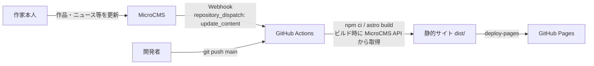

# 田中 優菜 ポートフォリオサイト（tanaka-yuuna-hp）

> Portfolio website for 田中 優菜 (Yuna Tanaka), 染織造形作家 — built with Astro + MicroCMS and deployed to GitHub Pages.

**公開URL：** https://nekopath-dev.github.io/tanaka-yuuna-hp/

## 概要

染織造形作家・田中 優菜 の作品・活動を紹介するポートフォリオサイトです。
作家本人からの依頼を受けて制作しました。

作品・ニュース・プロジェクトなどのコンテンツは MicroCMS で管理しており、作家本人が管理画面から更新すると、自動でサイトが再ビルド・再デプロイされます。

- 制作期間：2026年2月〜3月（コミット履歴：2026-02-05 〜 2026-03-11）
- 現在も公開・運用中

## 制作の経緯

1. **依頼** — 作家本人から、作品や活動を紹介するサイトの制作を依頼される
2. **ヒアリング** — サイトに対する作家本人の意向をヒアリング
3. **デザイン案の作成** — Google Stitch で複数のデザイン案を作成
4. **選定** — 作家本人にデザインを選んでもらう
5. **実装** — Astro + MicroCMS で実装し、GitHub Pages で公開

`参考デザイン/` には Google Stitch が出力したデザイン（Home / About / Works / Research / News / Contact / 各詳細ページの計9画面）を保存しています。
なお Stitch の出力には作家名・肩書の誤りが含まれていたため、実装時に `AI memory/02_デザイン統一ルール.txt` のルールで表記を統一しています。

## 主なページ

| パス | ページ | 内容 |
| --- | --- | --- |
| `/` | トップ | ヒーロー、About、最新ニュース・作品・プロジェクト（各3件） |
| `/about` | 作家について | プロフィール、略歴 |
| `/news` | 最新情報 | ニュース一覧 |
| `/news/[id]` | ニュース詳細 | 本文、イベント情報（会期・会場など） |
| `/works` | 作品 | 作品一覧 |
| `/works/[slug]` | 作品詳細 | 作品情報、ギャラリー、前後の作品へのナビゲーション |
| `/projects` | プロジェクト | プロジェクト一覧 |
| `/projects/[id]` | プロジェクト詳細 | 本文、同カテゴリの関連プロジェクト |
| `/contact` | お問い合わせ | メールアドレス（mailto リンク）、SNS |

デスクトップではサイドバー、モバイルではヘッダー＋ハンバーガーメニューでナビゲーションします。

## 技術スタック

| 分類 | 使用技術 |
| --- | --- |
| フレームワーク | [Astro](https://astro.build/) 5（`output: "static"` による静的サイト生成） |
| CMS | [MicroCMS](https://microcms.io/)（`microcms-js-sdk`） |
| スタイリング | Tailwind CSS 3（`@astrojs/tailwind`） |
| 言語 | TypeScript（`astro/tsconfigs/strict`） |
| アイコン | Material Symbols（Google Fonts） |
| CI/CD | GitHub Actions |
| ホスティング | GitHub Pages |

## アーキテクチャ



- ビルド時に MicroCMS からコンテンツを取得し、全ページを静的HTMLとして生成します（動的ルートは `getStaticPaths()` で生成）。
- ワークフロー（`.github/workflows/deploy.yml`）は次の3つで起動します。
  - `main` ブランチへの push
  - `repository_dispatch`（type: `update_content`）— MicroCMS の Webhook から送信
  - `workflow_dispatch`（手動実行）

## CMS運用

作家本人が MicroCMS の管理画面から、コードに触れずにサイトの内容を更新できる構成にしています。
アーティスト名・肩書・連絡先・SNS・Copyright などのテキストもコードにハードコードせず、CMS から取得しています。

MicroCMS の API は次の4つです（詳細は `AI memory/03_MicroCMS_API設計.txt`）。

| エンドポイント | 形式 | 用途 |
| --- | --- | --- |
| `global_settings` | オブジェクト | サイト全体の設定（作家名・肩書、ヒーロー、About、略歴、連絡先、SNS、Copyright など） |
| `works` | リスト | 作品（作品名、カテゴリ、画像・ギャラリー、制作年、技法、素材、解説など）。`slug` でルーティング |
| `news` | リスト | ニュース・イベント情報（カテゴリ、公開日、本文、会期・会場などのイベント情報） |
| `research` | リスト | プロジェクト。サイト上では `/projects` として表示 |

## 生成AIと協働する開発の工夫

生成AIと協働して開発するため、AIに渡す前提知識を `AI memory/` に設計メモとして整理しています。

| ファイル | 内容 |
| --- | --- |
| `01_プロジェクト概要.txt` | 作家情報（名前・肩書の正しい表記）、技術スタック、環境変数 |
| `02_デザイン統一ルール.txt` | 表記ルール、ナビゲーション、フッター、ハードコード禁止など |
| `03_MicroCMS_API設計.txt` | 4つのAPIのフィールド設計 |
| `04_ファイル構造.txt` | ディレクトリ構成と各ファイルの役割 |
| `05_技術メモ.txt` | SSGの動的ルート、画像最適化、リッチエディタ表示、デプロイ設定など |
| `06_ページ構成とデータマッピング.txt` | 各ページとCMSデータの対応 |

例えば、デザイン生成AIが作家名や肩書を誤って出力した経験から、正しい表記を `01` と `02` に明記し、以降の作業でAIが同じ誤りを繰り返さないようにしています。

## 今後の予定

- **ペルソナ切り替え機能（計画中）** — ボタン操作でサイトの表示を「染織造形作家」と「エッセイ漫画作者」の2つのペルソナで切り替える機能。計画は [`docs/persona-switch-plan.md`](docs/persona-switch-plan.md) にまとめています（`main` には未反映）。

## ローカル開発

```bash
npm install
cp .env.example .env   # MicroCMS の値を設定
npm run dev
```

`.env` に設定する環境変数：

| 変数名 | 内容 |
| --- | --- |
| `MICROCMS_SERVICE_DOMAIN` | MicroCMS のサービスドメイン |
| `MICROCMS_API_KEY` | MicroCMS の API キー |

その他のコマンド：

```bash
npm run build     # dist/ に静的サイトを生成
npm run preview   # ビルド結果をプレビュー
```

## デプロイ

GitHub Actions で GitHub Pages にデプロイしています（`astro.config.mjs` で `site: https://nekopath-dev.github.io`、`base: /tanaka-yuuna-hp`）。

必要な設定：

1. リポジトリの Settings > Pages > Source を「GitHub Actions」にする
2. リポジトリの Secrets に `MICROCMS_SERVICE_DOMAIN` と `MICROCMS_API_KEY` を登録する
3. MicroCMS の管理画面で、GitHub の `repository_dispatch` を呼び出す Webhook を設定する（GitHub の Personal Access Token が必要）

## 作者

- 制作：[@nekopath-dev](https://github.com/nekopath-dev)
- 依頼主：田中 優菜（染織造形作家）

## 著作権

本サイトに掲載している作品画像・テキストなどのコンテンツの著作権は、作家本人（田中 優菜）に帰属します。無断での転載・利用はご遠慮ください。
